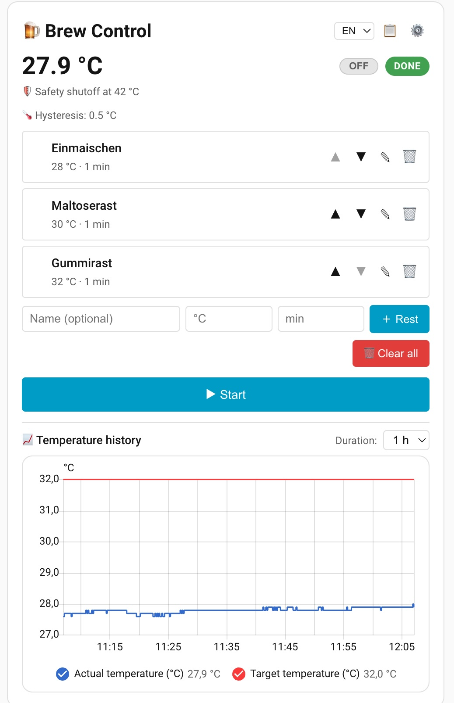
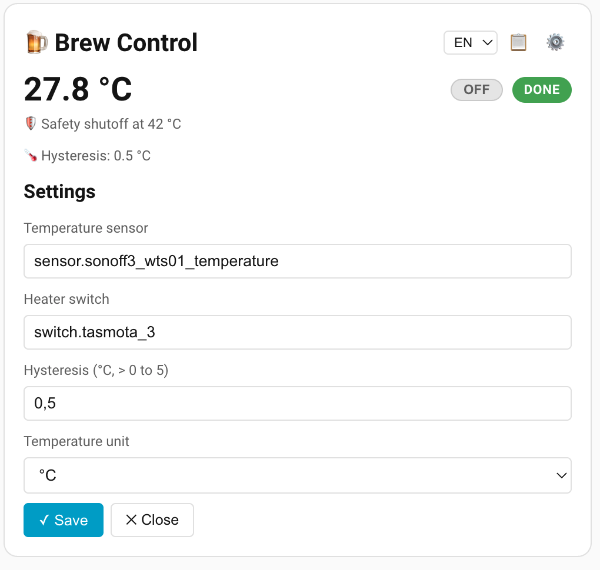
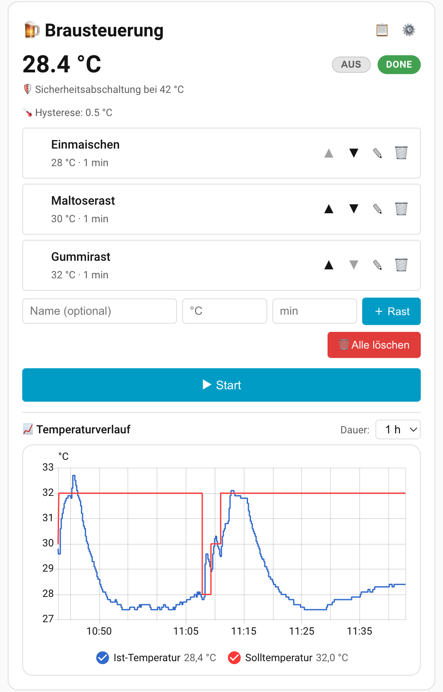

# 🍺 HA-Beer-Brew-Control

🇬🇧 **English** · 🇩🇪 [Deutsch](README.de.md)

[](https://my.home-assistant.io/redirect/hacs_repository/?owner=JamFfm&repository=HA-Beer-Brew-Control&category=integration)

## 1. Overview

HA-Beer-Brew-Control is a brewhouse/mash controller (brew control) for homebrewers.
Since version 3.0.0 it is a **Home Assistant integration written in Python** that is
installed via **HACS**. The familiar Lovelace card is kept and is served by the
integration itself.

Each rest consists of a name, a target temperature and a hold time. The
integration reads the actual temperature from a temperature sensor entity,
controls a heater actuator (switch) towards the target temperature using
hysteresis and automatically moves on to the next rest once the hold time has
elapsed. Control and safety functions run entirely on the Home Assistant server,
not in the browser. Helpers and automations from
`configuration.yaml`/`automations.yaml` are no longer needed.

<table>
  <tr>
    <td rowspan="2"></td>
    <td></td>
  </tr>
  <tr>
    <td style="background-color:#ffffff"></td>
  </tr>
</table>



*This is what the HA-Beer-Brew-Control card looks like in Home Assistant.*

---

## 2. ⚠️ Safety first

> **This software does not replace independent hardware protection.**
>
> - An over-temperature protection that is **independent** of the system (e.g. a
>   mechanical temperature limiter / safety temperature limiter, STB) is
>   **mandatory**.
> - The heater actuator **must** physically switch off if Home Assistant fails
>   (de-energised = heater off).
> - **Never** operate the system **unattended**.
> - When upgrading from v2.x, the 5 old automations and all 13 helpers **must**
>   be removed. Two controllers must never switch the same heater
>   (see [Migration from v2.x](#6-migration-from-v2x)).
>
> Details: [Control & safety concept](#10-control--safety-concept).

---

## 3. Features

- Recipes with up to 30 rests (name, target temperature 0–100 °C, hold time
  1–1440 min); edit, delete and reorder before starting.
- Automatic sequence: heating up, holding via hysteresis, next rest, completion
  with a notification. Manual skip via “⏭ Next rest”.
- Recipe library (up to 100 recipes), shared by all users of the instance.
- Over-temperature protection (𝚫t offset above the target temperature),
  protection against communication loss, watchdogs for stale sensor values and
  stuck actuators.
- Safe default state: heater OFF on setup, unload, restart and stop of Home
  Assistant; brewing never resumes automatically after a restart.
- Entities (sensors, buttons, selects, numbers) and services for your own
  automations and dashboards.
- User interface in English and German, display in °C or °F.
- Temperature history via the native `history-graph` card.
- No additional Python packages, no cloud or network access.

---

## 4. Installation via HACS

Requirements: Home Assistant **2026.6** or newer (tested with 2026.10.4),
[HACS](https://hacs.xyz/) installed, a temperature sensor entity (`sensor.*`)
and a heater actuator (`switch.*`).

The quickest way is the button above or this link: it opens HACS in your own
Home Assistant instance (from HA 2026.11 the Marketplace) and offers to add the
repository as a custom repository; then continue with step 3.

[](https://my.home-assistant.io/redirect/hacs_repository/?owner=JamFfm&repository=HA-Beer-Brew-Control&category=integration)

1. Open **HACS** → menu **⋮** → **Custom repositories**.
2. Enter the repository `https://github.com/JamFfm/HA-Beer-Brew-Control`,
   category **Integration**, **Add**.
3. Search HACS for **HA-Beer-Brew-Control** → **Download**.
4. **Restart Home Assistant.**
5. **Settings → Devices & services → Add integration → HA-Beer-Brew-Control**.
   Choose the temperature sensor, heater actuator, hysteresis, safety offset,
   language and unit.
6. Edit the dashboard → **Add card** → **HA-Beer-Brew-Control** (or manually
   `type: custom:brausteuerung-card`).

You do **not** need to add a dashboard resource: the integration serves the card
under `/brausteuerung_frontend/` and registers it in the frontend automatically.

> **Marketplace note:** From Home Assistant 2026.11, HACS is also available via
> the Home Assistant Marketplace. Once HA-Beer-Brew-Control has been accepted
> into the HACS default store (see
> [Publishing](#15-publishing-in-the-hacs-default-store)), steps 1–2 are no
> longer needed; it can then be found directly via the search.

---

## 5. Manual installation

1. Copy the folder `custom_components/brausteuerung` from this repository to
   `<config>/custom_components/brausteuerung` (including `frontend/`,
   `translations/` and `brand/`).
2. Restart Home Assistant.
3. Continue as with HACS from step 5.

**Fallback, only if the card does not appear in the card picker:** under
**Settings → Dashboards → Resources** add the resource
`/brausteuerung_frontend/brausteuerung-card.js?v=3.0.4` of type
**JavaScript module**.

---

## 6. Migration from v2.x

The integration takes over the previous settings, the active recipe and the
recipe library. Perform the steps **in exactly this order**:

1. Download the integration via HACS (section 4, steps 1–3), **do not restart
   yet**.
2. **Before restarting**, remove the old dashboard resource
   `/local/brausteuerung-card.js` (**Settings → Dashboards → Resources**).
   Otherwise the old card may claim the `brausteuerung-card` element first.
3. Restart Home Assistant.
4. **Add the integration** (section 4, step 5). The dialog is pre-filled with
   the values of the old helpers; the active recipe and its name are taken over
   once.
5. Open the card **once as an administrator**. It then moves the recipe library
   from the user storage into the integration (existing names are not
   overwritten). The old data is kept as a backup.
6. **The 5 automations and all 13 helpers MUST be removed**, as well as the
   files `www/brausteuerung-card.js` and `www/brausteuerung-logic.js`:
   - Automations: `brausteuerung_raststufe`, `brausteuerung_notaus`,
     `brausteuerung_manueller_wechsel`, `brausteuerung_uebertemperatur`,
     `brausteuerung_komm_verlust`.
   - Helpers: all `input_text.brau_*`, `input_number.brau_*`,
     `input_select.brau_*`, `timer.brau_raststufe` and
     `input_button.brau_naechste_rast` from `configuration.yaml`.
   - Then restart Home Assistant and reload the browser.

Notes:

- As long as leftovers exist, **Settings → System → Repairs** shows matching
  issues (old automations, old helpers, old resource).
- **Start lock:** If an old automation is still enabled, the integration refuses
  to start a brew (`legacy_automations_active`). Only the 5 old automations are
  detected (by their `id` from `automations.yaml` or their original entity ID).
  Your own automations that operate the new integration do not block the start,
  even if their name begins with “Brausteuerung”.
- Libraries of users **without** admin rights are not migrated automatically.
- The `legacy/` folder contains the old YAML files for v2.x reference only.
  They are **not** needed for v3.

---

## 7. Usage

### Switching the language (EN/DE)

The card header contains a **language switch** (`EN`/`DE`). It lets you switch
the user interface between **English** (default) and **German** at any time.
The choice is stored in the integration (entity `select.brausteuerung_language`)
and also applies to the **notification texts** (e.g. over-temperature,
communication loss, end of brew). If the value is missing or invalid, English is
used.

### Active recipe name

The name of the currently active recipe is shown **in bold at the top centre**
of the card header. It is stored in the integration (like the recipe library)
and is therefore the same for all users.

- **No recipe selected:** the placeholder **“New recipe”** is shown
  (German: “Neues Rezept”).
- **Recipe loaded or saved:** when using **📥 Load** from the library and
  **💾 Save**, the card takes over the respective recipe name.
- **Recipe modified:** if a named recipe is changed (rest added, deleted,
  edited or reordered), the integration appends **“New”** to the name on the
  **first** change, e.g. `Pale Ale` → `Pale Ale New`. All **further** changes
  leave the name unchanged — the name is not extended again on every change.
- **Name collision:** if the name with “New” already exists in the library, a
  number is counted up: `Pale Ale New 2`, `Pale Ale New 3`, …

The first change is detected by comparing with the recipe library: the active
recipe only counts as unchanged as long as it matches the stored library entry
by name **and** content. This keeps the behaviour correct even after reloading
the page. A recipe without a name (placeholder “New recipe”) does not get a
“New” suffix — simply enter a name when using **💾 Save**. Editing with
unchanged values does not rename the recipe.

### Creating a recipe / rests

Enter the following for each rest:

- **Name** — optional. If the field is left empty, the integration automatically
  assigns the default name `Rast N` (with `N` = position of the rest).
- **Target temperature** — valid values are **0 °C to 100 °C**.
- **Hold time** — valid values are **whole minutes greater than 0** (at most
  1440).

Invalid input (target temperature outside 0–100 °C, hold time ≤ 0 or not a whole
number) is **not** accepted; the recipe remains unchanged.

Before starting, rests can be edited via **✎** and deleted via **✕**. The arrow
buttons **▲ / ▼** let you change the order of the rests freely before starting;
the new order is saved immediately. The rests are processed in exactly the order
present when **▶ Start** is pressed. While a process is running, editing,
deleting and reordering are locked.

A recipe can contain up to **30 rests**; names can be up to **64 characters**
long. The former 255-character limit no longer exists.

### Controlling the brewing process

- **▶ Start** — starts with the first rest and sets the status to `running`.
  Start is only available if the recipe contains at least one rest **and** a
  valid actual temperature is available.
- **⏹ Stop** — switches the heater off immediately and cancels the running timer.
- **⏭ Next rest** — manual rest change: cancels the running timer and jumps to
  the next rest. On the last rest this completes the brewing process (heater
  off, status `done`, notification).

While a process is running, the card additionally shows the **remaining hold
time** of the active rest as a real-time countdown accurate to the second.

### Temperature history graph

Below the controls the card shows a **temperature history graph**. It embeds the
**native Home Assistant history card (`history-graph`)** and therefore displays
the **real history data from the HA recorder** — the **actual temperature** of
the configured sensor and the **target temperature in red**
(`sensor.brausteuerung_target_temperature`). The **“Duration” selector** lets you
choose how many hours are shown (1–4 h). For details see section
[Temperature history / charts](#temperature-history--charts).

### Heater actuator: display and manual switching

As soon as a valid heater actuator (domain `switch.*`) is selected, the card
shows its state in real time next to the actual temperature. If the actuator is
on, a coloured **🔥 flame icon** is shown as well.

The state can be toggled manually at any time via the display (ON/OFF).
**Note:** While a brewing process is running, the hysteresis control may override
the manually set state at any time according to the control logic.

### Recipe management (save, load, delete)

The **📋 icon** in the header opens the recipe management. There you can store
several named brewing recipes in a **recipe library** and reuse them:

- **💾 Save** — stores the recipe currently visible (active) in the card under a
  name of your choice in the library. If the name already exists, you are asked
  for confirmation before it is overwritten.
- **📥 Load** — loads a saved recipe as the active recipe so that it can be
  edited or started. Loading is locked while a brewing process is running.
- **🗑 Delete** — removes a recipe from the library.

**Important note on storage:** The recipe library is stored in the integration
(`.storage/brausteuerung.data`) and is **the same for all users** of this Home
Assistant instance. It holds up to 100 recipes.

### Settings (⚙️)

The **⚙️ icon** is used to change the temperature sensor, heater actuator,
hysteresis and safety offset (𝚫t) (without a running brew the card shows the
offset as 𝚫t; during the brew and while paused it shows the actual shutoff
temperature). Only **administrators** may change these settings (see
[Permission model](#9-permission-model)); they are also available under
**Settings → Devices & services → HA-Beer-Brew-Control → Configure**. Sensor and
heater cannot be changed while a brew is running.

---

## 8. Entities, services and WebSocket commands

All entities belong to the device **HA-Beer-Brew-Control**.

| Entity | Meaning |
|---|---|
| `sensor.brausteuerung_status` | `idle`, `running`, `paused`, `done` |
| `sensor.brausteuerung_current_rest` | name of the active rest |
| `sensor.brausteuerung_target_temperature` | current target temperature (for the graph) |
| `sensor.brausteuerung_safety_threshold` | safety threshold (target + 𝚫t) |
| `sensor.brausteuerung_hold_end` | end of the hold time (timestamp) |
| `sensor.brausteuerung_brew_started` | start of the brew (timestamp) |
| `button.brausteuerung_start` / `_stop` / `_next_rest` | Start, Stop, Next rest |
| `select.brausteuerung_language` / `_unit` | language, unit |
| `number.brausteuerung_hysteresis` / `_safety_offset` | hysteresis, safety offset (admin only) |

Services (domain `brausteuerung`): `start`, `stop`, `next_rest`, `add_rest`,
`update_rest`, `delete_rest`, `move_rest`, `clear_recipe`, `save_recipe`,
`load_recipe`, `delete_recipe`. Descriptions and fields are available under
**Developer tools → Actions**.

WebSocket commands of the card (prefix `brausteuerung/`): `subscribe`, `rest/add`,
`rest/update`, `rest/delete`, `rest/move`, `recipe/clear`, `library/save`,
`library/load`, `library/delete`, `library/import` (admin), `control/start`,
`control/stop`, `control/next_rest`, `settings/update` (admin),
`display/update`.

---

## 9. Permission model

- **Administrators only:** changing settings (`settings/update`, options dialog),
  hysteresis/offset via `number.set_value`, library import (`library/import`).
  This covers everything that determines safety: which actuator, which
  threshold, which band.
- **All logged-in users:** editing the recipe, library (save/load/delete),
  Start, Stop, Next rest, language and unit.
- **Stop** is never restricted.
- Calls without a user (automations, system) are allowed.
- Manual switching of the heater continues to go through the `switch` entity
  with Home Assistant's permissions.

---

## 10. Control & safety concept

### Hysteresis band (configurable, default 1.0 °C)

During the hold phase the controller regulates the actual temperature with a
configurable hysteresis band below the target temperature:

- Actual temperature **< target − hysteresis** → heater **ON**
- Actual temperature **≥ target** → heater **OFF**
- Actual temperature **within the band** (target − hysteresis ≤ actual < target)
  → state remains unchanged

Valid values are **0.1 °C to 5 °C**, default **1.0 °C**.

### Safety offset (𝚫t) and over-temperature protection

```
Threshold = target temperature + safety offset (𝚫t)
```

Example: target temperature 67 °C, 𝚫t 10 °C → shutoff at 77 °C. Valid values are
0–20 °C, default 10 °C. If the actual temperature exceeds the threshold (in
`running` and `paused`), the integration switches the heater off immediately,
sets the status to `paused` and sends one notification per event. Resuming
requires a deliberate user action.

Without a running brew (`idle`, `done`) the card shows the offset as
“Safety shutoff at 𝚫t …”; during the brew (and while paused) it shows the
actual shutoff temperature without 𝚫t.

### What the software does (fail-safe)

- **Heater OFF** on setup (initial OFF), when unloading/reloading the
  integration, on Stop, at the end of the brew and when Home Assistant shuts
  down. On HA stop the heater is switched off first, **before** other
  integrations are stopped (shutdown job, at most 5 s + 5 s), and once more on
  the stop event.
- **No auto-resume:** after a restart the status is `idle`; an interrupted brew
  is not resumed on its own.
- **Communication loss:** invalid sensor value in `running` → heater OFF
  immediately. If the value stays invalid for `COMM_LOSS_TIMEOUT` = **30 s** →
  `paused` and notification.
- **Stale sensor value (watchdog):** if the heater has been on for at least
  `STALE_SENSOR_TIMEOUT` = **10 min** and the sensor has not reported anything
  for 10 min → `paused`, heater OFF, notification. It never triggers while the
  heater is off (no false alarms for sensors that only report changes).
- **Actuator watchdog:** `ACTUATOR_VERIFY_DELAY` = **15 s** after every OFF
  command it checks whether the actuator is really off. If not: another OFF
  command, a one-time notification, `paused`; at most `ACTUATOR_MAX_RETRIES` =
  **3** retries, after that only a log entry. If the actuator is unreachable in
  `running` for `ACTUATOR_UNAVAILABLE_TIMEOUT` = **30 s** → `paused` and
  notification.
- **No command flooding:** OFF is not repeated every second. If the initial OFF
  fails, a new attempt follows on a state change or at most every
  `INITIAL_OFF_RETRY_INTERVAL` = **60 s**. Individual actuator calls have a
  timeout of 10 s.
- **Errors in the code:** every unexpected exception results in heater OFF and
  `paused`.
- **Preventing two controllers:** start lock as long as old v2.x automations are
  active.
- **No network access:** no external packages, no outgoing connections, no
  `eval`/`exec`. All input is validated on the server.
- The static path `/brausteuerung_frontend/` can be accessed without login, like
  `/local/`, and only serves the card's two JS files, no data.

### What the software explicitly does NOT replace

An independent temperature limiter (STB), an actuator that switches off by
itself if Home Assistant fails, and supervision by a human.

### ⚠️ Important safety notes

HA-Beer-Brew-Control controls real hardware at high temperatures. The following
notes **must** be observed:

- **Independent hardware over-temperature protection (required):** In addition
  to the software monitoring, a hardware over-temperature protection that is
  **independent** of the system (e.g. a mechanical temperature limiter / STB)
  must be used. It must work independently of Home Assistant, the sensor entity
  and the automations.
- **Physical shutoff if HA fails (required):** The heater actuator **must** be
  able to switch off physically if Home Assistant fails. Choose an actuator
  that opens when de-energised or not driven (heater off), so that a software
  or connection failure cannot lead to uncontrolled heating.
- **Never** operate the system **unattended**.

---

## 11. Storage locations

- **Recipe, recipe name and library:** `<config>/.storage/brausteuerung.data`,
  shared by all users of the instance.
- **Settings** (sensor, heater, hysteresis, offset, language, unit): in the
  options of the config entry (`.storage/core.config_entries`).
- **Runtime state** (status, active rest, timer): in memory only, `idle` after a
  restart.
- **Display duration of the graph:** per user in the HA user storage.
- When the integration is removed, the data in `.storage/brausteuerung.data` is
  kept.
- Write errors (e.g. full disk) are reported by Home Assistant itself in the
  log. The change is then only effective until the next restart.

---

## 12. Temperature history and sensor calibration

### Temperature history / charts

The card embeds the **native Home Assistant history card (`history-graph`)**
directly into the HA-Beer-Brew-Control card. The graph therefore uses the same
presentation as the built-in HA charts and reads the **real history data from
the HA recorder**:

- **Actual and target temperature:** the **actual temperature** of the
  configured sensor and the **target temperature**
  (`sensor.brausteuerung_target_temperature`) are shown. The target temperature
  is drawn **in red** (`color: "red"`, supported from Home Assistant
  **2026.6**).
- **Real history from the recorder:** the history is not recorded in the card
  but comes from the HA recorder. It is therefore immediately complete again
  after a reload, a view/desktop switch or a restart, and updates live.
- **Window starts with the brew:** as soon as a brew is running, the time window
  of the graph is limited to the **start time** (`hours_to_show` = time since
  start, capped at the selected duration). As a result **both** lines (actual
  and target temperature) begin with the brew; older values lie outside the
  window and are not shown — without deleting anything from the database. If
  the brew runs longer than the selected duration, it becomes a normal sliding
  window (1–4 h). This also works if the brew is started externally (e.g. by an
  automation).
- **Selectable display duration (1–4 h):** the **“Duration”** selector in the
  graph header sets `hours_to_show` (1, 2, 3 or 4 hours). The choice is stored
  **per user** in the HA user storage.
- **Labelled axes:** the axes (time and temperature) are labelled and scaled by
  the native HA card.

> **Requirements:** The **recorder** must be active (default in Home
> Assistant) and record both the sensor entity and
> `sensor.brausteuerung_target_temperature`. Both are recorded by default; if
> you have filtered the recorder (`include`/`exclude`), make sure these
> entities are included.

For **long-term** recording over days/weeks (long-term statistics, zoom) you can
additionally add your own **`statistics-graph`** card to the dashboard, e.g.:

```yaml
type: statistics-graph
entities:
  - sensor.ds18b20_maische
days_to_show: 0.1
period: 1minute
chart_type: line
stat_types:
  - mean
```

### Sensor offset (calibration) — in Home Assistant

A **sensor offset** for calibrating the actual temperature (e.g. if the
temperature probe systematically reads 1–2 °C too high or too low) is **not**
set in HA-Beer-Brew-Control itself, but directly in **Home Assistant**.
HA-Beer-Brew-Control reads the sensor value unchanged from the selected entity.

Recommended approach: create a helper or a derived sensor entity in HA that
corrects the raw value by the offset, and then select this corrected entity as
the temperature sensor in HA-Beer-Brew-Control. Examples:

- Create a suitable helper via **Settings → Devices & services → Helpers**, or
- define a **template sensor** in `configuration.yaml`, e.g.:

  ```yaml
  template:
    - sensor:
        - name: "Maische Temperatur (kalibriert)"
          unit_of_measurement: "°C"
          state: "{{ states('sensor.ds18b20_maische') | float(0) + 0.5 }}"
  ```

  Then select the resulting sensor (`sensor.maische_temperatur_kalibriert`) in
  the **Sensor** field of the settings.

---

## 13. Updates

Updates are delivered via HACS (**HACS → HA-Beer-Brew-Control → Update**, then
restart Home Assistant). There is no need to version the resource manually: the
integration registers the card with its version (`?v=3.0.4`), and the browser
loads the new file automatically after an update. If the loaded card does not
match the version of the integration, the card shows a notice; then reload the
page.

---

## 14. Development & tests

Python 3.14 with [uv](https://docs.astral.sh/uv/):

```bash
uv venv --python 3.14 .venv
uv pip install --python .venv/bin/python -r requirements_test.txt

.venv/bin/pytest tests/ --cov --cov-report=term-missing   # integration tests
.venv/bin/ruff check custom_components tests                # lint
```

The card is tested with [Vitest](https://vitest.dev/) (Node.js required):

```bash
npm install
npm run test:run
```

The GitHub Action `.github/workflows/validate.yml` runs the HACS validation and
`hassfest`. These steps are **not** required for running the integration in
Home Assistant.

**Documentation in two languages:** The documentation is available in English
([`README.md`](README.md), the default for GitHub and HACS) and in German
([`README.de.md`](README.de.md)). Every change must be applied to **both**
files; `tests/test_repo_consistency.py` checks that both versions stay in sync.

---

## 15. Publishing in the HACS default store

1. Create the public GitHub repository
   [`JamFfm/HA-Beer-Brew-Control`](https://github.com/JamFfm/HA-Beer-Brew-Control)
   with a description and topics; the `Validate` action (HACS and hassfest)
   must be green.
2. The icon is located at `custom_components/brausteuerung/brand/icon.png`.
3. Create a GitHub **release** (e.g. `v3.0.4`). Before that, check that the
   folder `custom_components/brausteuerung/` is complete on GitHub (all `*.py`
   files and `translations/`, but no `__pycache__/`).
4. Open a pull request in the `hacs/default` repository (file `integration`).

---

## 16. CHANGELOG

### 3.0.4

- Manifest: added the category `appliances_cleaning.cooking` (“Appliances &
  cleaning → Cooking”) for HACS and the Marketplace. No functional change.

### 3.0.3

- Change: the line “Safety shutoff at …” only shows 𝚫t when the safety offset
  is displayed (`idle`, `done`). During the brew and while paused, the actual
  shutoff temperature is shown without 𝚫t.

### 3.0.2

- Fix: while the “Manage recipes” panel was open, the status block did not
  update (heater switch ON/OFF, actual temperature, countdown). It now updates
  live as in the main view; text typed into the name field is kept.

### 3.0.1

- Fix: adding the integration failed with “cannot import name 'validation' from
  partially initialized module … (circular import)”. The cause was not a
  circular import but files missing from the v3.0.0 release (including
  `validation.py`, `config_flow.py`, `const.py`, `translations/`). The release
  is complete; the integration now checks all module files when loading and
  names missing files in the log with a clear message.

### 3.0.0

- New: Python custom integration for HACS; control, sequence and safety run on
  the Home Assistant server.
- New: setup and settings via the configuration dialog, entities and services,
  takeover of the v2.x values and the library.
- New: watchdogs for stale sensor values and stuck actuators, heater OFF on
  shutdown, start lock while old automations are active, admin rights for
  safety-relevant settings.
- New: instance-wide recipe library; the 255-character limit is gone
  (up to 30 rests).
- The card is served by the integration; look and operation stay the same.
- Removed: helpers from `configuration.yaml` and the 5 automations from
  `automations.yaml` (kept for reference under `legacy/`).
