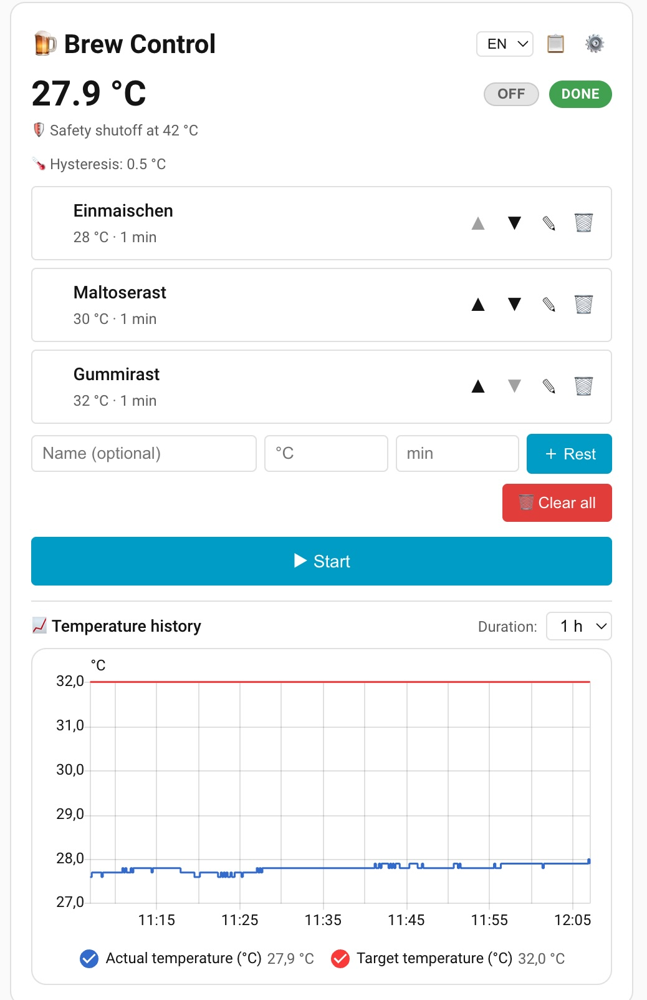
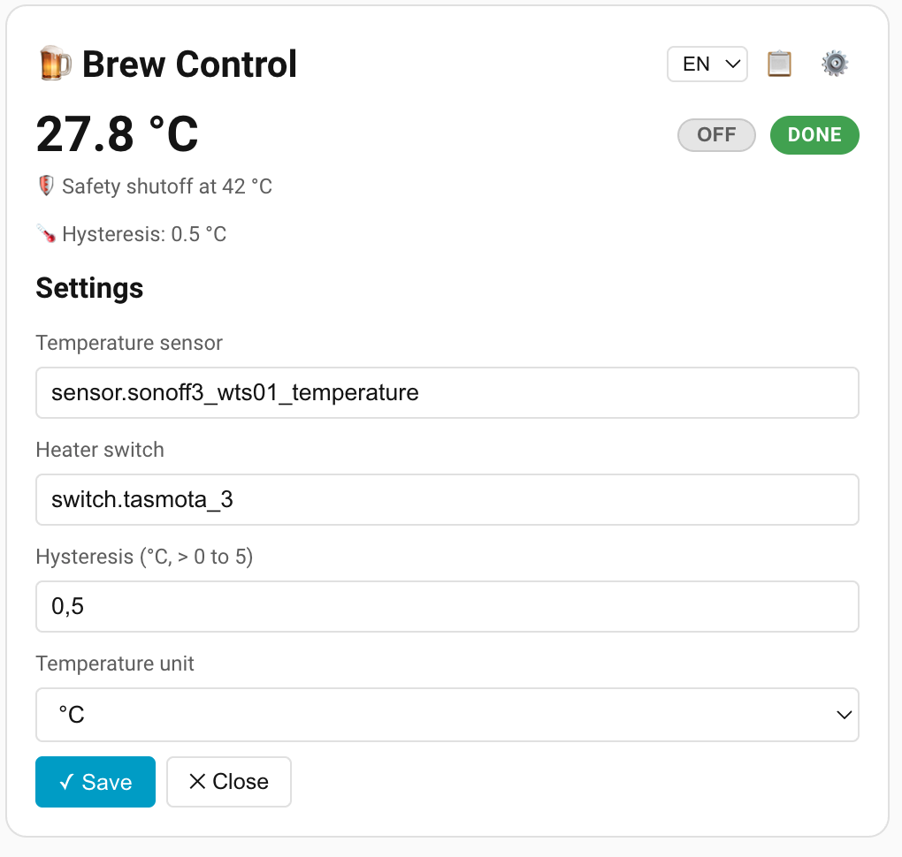
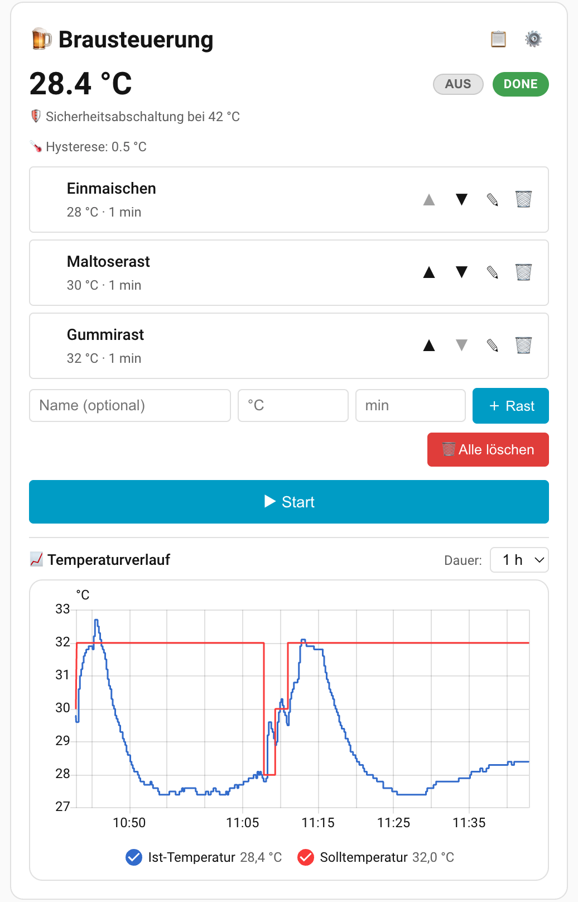

# 🍺 HA-Beer-Brew-Control

## 1. Kurzbeschreibung

HA-Beer-Brew-Control ist eine Sudhaus-/Maischesteuerung (Brausteuerung) für Hobbybrauer.
Ab Version 3.0.0 ist sie eine **Home-Assistant-Integration in Python**, die über **HACS**
installiert wird. Die bekannte Lovelace-Karte bleibt erhalten und wird von der
Integration selbst ausgeliefert.

Jede Raststufe besteht aus einem Namen, einer Solltemperatur und einer Haltezeit.
Die Integration liest die Ist-Temperatur aus einer Temperatursensor-Entität,
regelt einen Heizungs-Aktor (Schalter) per Hysterese auf die Solltemperatur und
wechselt nach Ablauf der Haltezeit automatisch zur nächsten Raststufe. Regelung
und Sicherheitsfunktionen laufen vollständig im Home-Assistant-Server, nicht im
Browser. Helfer und Automationen aus `configuration.yaml`/`automations.yaml`
werden nicht mehr benötigt.

<table>
  <tr>
    <td rowspan="2"></td>
    <td></td>
  </tr>
  <tr>
    <td style="background-color:#ffffff"></td>
  </tr>
</table>



*So sieht die in Home Assistant eingebundene HA-Beer-Brew-Control-Karte aus.*

---

## 2. ⚠️ Sicherheit zuerst

> **Diese Software ersetzt keinen unabhängigen Hardware-Schutz.**
>
> - Ein vom System **unabhängiger** Übertemperaturschutz (z. B. ein mechanischer
>   Temperaturbegrenzer / STB) ist **Pflicht**.
> - Der Heizungs-Aktor **muss** bei einem Ausfall von Home Assistant physisch
>   abschalten (stromlos = Heizung aus).
> - Betreibe die Anlage **nie unbeaufsichtigt**.
> - Beim Umstieg von v2.x **müssen** die 5 alten Automationen und alle 13 Helfer
>   entfernt werden. Zwei Regler dürfen nie dieselbe Heizung schalten
>   (siehe [Migration von v2.x](#6-migration-von-v2x)).
>
> Details: [Regelung & Sicherheitskonzept](#10-regelung--sicherheitskonzept).

---

## 3. Funktionsüberblick

- Rezepte mit bis zu 30 Raststufen (Name, Solltemperatur 0–100 °C, Haltezeit
  1–1440 min), Bearbeiten, Löschen und Umsortieren vor dem Start.
- Automatischer Ablauf: Aufheizen, Halten per Hysterese, nächste Rast, Abschluss
  mit Benachrichtigung. Manueller Sprung über „⏭ Nächste Rast“.
- Rezept-Bibliothek (bis zu 100 Rezepte), instanzweit für alle Benutzer.
- Übertemperaturschutz (𝚫t-Offset über der Solltemperatur), Schutz bei
  Kommunikationsverlust, Watchdogs für veraltete Sensorwerte und hängende Aktoren.
- Sichere Grundstellung: Heizung AUS beim Start, Entladen, Neustart und Stop von
  Home Assistant; kein automatisches Weiterbrauen nach einem Neustart.
- Entitäten (Sensoren, Buttons, Auswahlen, Zahlen) und Services für eigene
  Automationen und Dashboards.
- Oberfläche auf Englisch und Deutsch, Anzeige in °C oder °F.
- Temperaturverlauf über die native `history-graph`-Karte.
- Keine zusätzlichen Python-Pakete, kein Cloud- oder Netzwerkzugriff.

---

## 4. Installation über HACS

Voraussetzungen: Home Assistant **2026.6** oder neuer (getestet mit 2026.10.4),
[HACS](https://hacs.xyz/) installiert, eine Temperatursensor-Entität (`sensor.*`)
und ein Heizungs-Aktor (`switch.*`).

1. **HACS** öffnen → Menü **⋮** → **Benutzerdefinierte Repositories**.
2. Repository `https://github.com/JamFfm/HA-Beer-Brew-Control`
   eintragen, Kategorie **Integration**, **Hinzufügen**.
3. In HACS nach **HA-Beer-Brew-Control** suchen → **Herunterladen**.
4. **Home Assistant neu starten.**
5. **Einstellungen → Geräte & Dienste → Integration hinzufügen → HA-Beer-Brew-Control**.
   Temperatursensor, Heizungs-Aktor, Hysterese, Sicherheits-Offset, Sprache und
   Einheit wählen.
6. Dashboard bearbeiten → **Karte hinzufügen** → **HA-Beer-Brew-Control** (bzw. manuell
   `type: custom:brausteuerung-card`).

Eine Dashboard-Ressource muss **nicht** angelegt werden: Die Integration liefert
die Karte unter `/brausteuerung_frontend/` aus und bindet sie automatisch ins
Frontend ein.

> **Hinweis Marketplace:** Ab Home Assistant 2026.11 ist HACS auch über den
> Home-Assistant-Marketplace erreichbar. Sobald HA-Beer-Brew-Control im
> HACS-Default-Store aufgenommen ist (siehe
> [Veröffentlichung](#15-veröffentlichung-im-hacs-default-store)), entfällt
> Schritt 1–2; sie lässt sich dann direkt über die Suche finden.

---

## 5. Manuelle Installation

1. Den Ordner `custom_components/brausteuerung` aus diesem Repository nach
   `<config>/custom_components/brausteuerung` kopieren (inklusive `frontend/`,
   `translations/` und `brand/`).
2. Home Assistant neu starten.
3. Weiter wie bei HACS ab Schritt 5.

**Notlösung, nur falls die Karte nicht im Kartenpicker erscheint:** unter
**Einstellungen → Dashboards → Ressourcen** die Ressource
`/brausteuerung_frontend/brausteuerung-card.js?v=3.0.1` vom Typ
**JavaScript-Modul** eintragen.

---

## 6. Migration von v2.x

Die Integration übernimmt die bisherigen Einstellungen, das aktive Rezept und die
Rezept-Bibliothek. Die Schritte **in genau dieser Reihenfolge** ausführen:

1. Integration über HACS herunterladen (Abschnitt 4, Schritte 1–3), **noch nicht
   neu starten**.
2. **Vor dem Neustart** die alte Dashboard-Ressource `/local/brausteuerung-card.js`
   entfernen (**Einstellungen → Dashboards → Ressourcen**). Sonst kann die alte
   Karte das Element `brausteuerung-card` zuerst belegen.
3. Home Assistant neu starten.
4. **Integration hinzufügen** (Abschnitt 4, Schritt 5). Der Dialog ist mit den
   Werten der alten Helfer vorbelegt; das aktive Rezept und sein Name werden
   einmalig übernommen.
5. Die Karte **einmal als Administrator** öffnen. Sie übernimmt dabei die
   Rezept-Bibliothek aus dem Benutzerspeicher in die Integration (vorhandene Namen
   werden nicht überschrieben). Die alten Daten bleiben als Sicherung erhalten.
6. **Die 5 Automationen und alle 13 Helfer MÜSSEN entfernt werden**, ebenso die
   Dateien `www/brausteuerung-card.js` und `www/brausteuerung-logic.js`:
   - Automationen: `brausteuerung_raststufe`, `brausteuerung_notaus`,
     `brausteuerung_manueller_wechsel`, `brausteuerung_uebertemperatur`,
     `brausteuerung_komm_verlust`.
   - Helfer: alle `input_text.brau_*`, `input_number.brau_*`,
     `input_select.brau_*`, `timer.brau_raststufe` und
     `input_button.brau_naechste_rast` aus der `configuration.yaml`.
   - Danach Home Assistant neu starten und den Browser neu laden.

Hinweise:

- Solange Altlasten vorhanden sind, zeigt **Einstellungen → System → Reparaturen**
  passende Meldungen (alte Automationen, alte Helfer, alte Ressource).
- **Start-Sperre:** Ist noch eine alte Automation eingeschaltet, verweigert die
  Integration den Start eines Brauvorgangs (`legacy_automations_active`).
  Erkannt werden nur die 5 alten Automationen (über ihre `id` aus
  `automations.yaml` bzw. ihre ursprüngliche Entity-ID). Eigene Automationen,
  die die neue Integration bedienen, sperren den Start nicht, auch wenn ihr Name
  mit „Brausteuerung“ beginnt.
- Bibliotheken von Benutzern **ohne** Admin-Rechte werden nicht automatisch
  übernommen.
- Der Ordner `legacy/` enthält die alten YAML-Dateien nur zur Referenz für v2.x.
  Für v3 werden sie **nicht** benötigt.

---

## 7. Bedienung

### Sprache umschalten (EN/DE)

In der Kopfzeile der Karte befindet sich ein **Sprachumschalter** (`EN`/`DE`).
Damit lässt sich die Oberfläche jederzeit zwischen **Englisch** (Standard) und
**Deutsch** wechseln. Die Wahl wird in der Integration gespeichert
(Entität `select.brausteuerung_language`) und gilt auch für die
**Benachrichtigungstexte** (z. B. Übertemperatur, Kommunikationsverlust,
Brauende). Fehlt der Wert oder ist er ungültig, wird Englisch verwendet.

### Name des aktiven Rezepts

In der Kopfzeile der Karte steht **oben in der Mitte fett** der Name des aktuell
aktiven Rezepts. Gespeichert wird er in der Integration (wie die
Rezept-Bibliothek) und steht damit allen Benutzern gleich zur Verfügung.

- **Kein Rezept ausgewählt:** Es erscheint der Platzhalter **„Neues Rezept"**
  (englisch: „New recipe").
- **Rezept geladen oder gespeichert:** Beim **📥 Laden** aus der Bibliothek und
  beim **💾 Speichern** übernimmt die Karte den jeweiligen Rezeptnamen.
- **Rezept verändert:** Wird ein benanntes Rezept angepasst (Rast hinzugefügt,
  gelöscht, bearbeitet oder umsortiert), hängt die Integration beim **ersten**
  Eingriff ein **„Neu"** an den Namen, z. B. `Helles` → `Helles Neu`. Alle
  **weiteren** Änderungen lassen den Namen unverändert — der Name wird also nicht
  bei jeder Änderung erneut ergänzt.
- **Namenskollision:** Existiert der Name mit „Neu" bereits in der Bibliothek,
  wird eine Zahl hochgezählt: `Helles Neu 2`, `Helles Neu 3`, …

Erkannt wird die erste Änderung über den Abgleich mit der Rezept-Bibliothek: Nur
solange das aktive Rezept namentlich **und** inhaltlich dem gespeicherten
Bibliothekseintrag entspricht, gilt es als unverändert. Das Verhalten bleibt
dadurch auch nach einem Neuladen der Seite korrekt. Ein Rezept ohne Namen
(Platzhalter „Neues Rezept") erhält kein „Neu"-Suffix — vergib beim
**💾 Speichern** einfach einen Namen. Eine Bearbeitung mit unveränderten Werten
benennt das Rezept nicht um.

### Rezept / Raststufen anlegen

Gib für jede Raststufe Folgendes ein:

- **Name** — optional. Bleibt das Feld leer, vergibt die Integration automatisch
  den Standardnamen `Rast N` (mit `N` = Position der Rast).
- **Solltemperatur** — gültig sind Werte von **0 °C bis 100 °C**.
- **Haltezeit** — gültig sind **ganze Minuten größer als 0** (höchstens 1440).

Ungültige Eingaben (Solltemperatur außerhalb 0–100 °C, Haltezeit ≤ 0 oder keine
ganze Zahl) werden **nicht** übernommen; das Rezept bleibt unverändert.

Raststufen können vor dem Start über **✎** editiert und über **✕** gelöscht werden.
Über die Pfeiltasten **▲ / ▼** lässt sich die Reihenfolge der Rasten vor dem Start
beliebig ändern; die neue Reihenfolge wird sofort gespeichert. Abgearbeitet werden
die Rasten in genau der Reihenfolge, die beim Drücken von **▶ Start** vorliegt.
Während eines laufenden Prozesses sind Editieren, Löschen und Umsortieren gesperrt.

Ein Rezept kann bis zu **30 Rasten** enthalten; Namen dürfen bis zu
**64 Zeichen** lang sein. Die frühere 255-Zeichen-Grenze gibt es nicht mehr.

### Brauprozess steuern

- **▶ Start** — startet mit der ersten Raststufe und setzt den Status auf `running`.
  Start ist nur verfügbar, wenn das Rezept mindestens eine Raststufe enthält **und**
  eine gültige Ist-Temperatur vorliegt.
- **⏹ Stop** — schaltet die Heizung sofort aus und bricht den laufenden Timer ab.
- **⏭ Nächste Rast** — manueller Stufenwechsel: bricht den laufenden Timer ab und
  springt zur nächsten Rast. Auf der letzten Rast wird damit der Brauprozess
  abgeschlossen (Heizung aus, Status `done`, Benachrichtigung).

Während eines laufenden Prozesses zeigt die Karte zusätzlich die **verbleibende
Haltezeit** der aktiven Rast als sekundengenauen Echtzeit-Countdown an.

### Temperaturverlauf-Graph

Unterhalb der Bedienelemente zeigt die Karte einen **Temperaturverlauf-Graphen**.
Dieser bettet die **native Home-Assistant-Verlaufskarte (`history-graph`)** ein und
stellt daher die **echten Verlaufsdaten aus dem HA-Recorder** dar — die
**Ist-Temperatur** des konfigurierten Sensors und die **Solltemperatur in Rot**
(`sensor.brausteuerung_target_temperature`). Über das **„Dauer"-Auswahlfeld**
wählst du, wie viele Stunden angezeigt werden (1–4 h). Details siehe Abschnitt
[Temperaturverlauf / Diagramme](#temperaturverlauf--diagramme).

### Heizungs-Aktor: Anzeige und manuelles Schalten

Sobald ein gültiger Heizungs-Aktor (Domäne `switch.*`) ausgewählt ist, zeigt die
Karte dessen Zustand in Echtzeit neben der Ist-Temperatur an. Ist der Aktor
eingeschaltet, erscheint zusätzlich ein farbiges **🔥 Flammensymbol**.

Der Zustand lässt sich jederzeit über die Anzeige manuell umschalten (AN/AUS).
**Hinweis:** Während eines laufenden Brauprozesses kann die Hysterese-Regelung den
manuell gesetzten Zustand jederzeit gemäß Regelung wieder überschreiben.

### Rezeptverwaltung (Speichern, Laden, Löschen)

Über das **📋-Symbol** in der Kopfzeile öffnest du die Rezeptverwaltung. Dort
kannst du mehrere benannte Braurezepte in einer **Rezept-Bibliothek** ablegen und
wiederverwenden:

- **💾 Speichern** — legt das aktuell in der Karte sichtbare (aktive) Rezept
  unter einem frei wählbaren Namen in der Bibliothek ab. Existiert der Name
  bereits, wird vor dem Überschreiben eine Bestätigung abgefragt.
- **📥 Laden** — lädt ein gespeichertes Rezept als aktives Rezept, sodass es
  bearbeitet oder gestartet werden kann. Während eines laufenden Brauprozesses
  ist das Laden gesperrt.
- **🗑 Löschen** — entfernt ein Rezept aus der Bibliothek.

**Wichtig zur Speicherung:** Die Rezept-Bibliothek liegt in der Integration
(`.storage/brausteuerung.data`) und ist **für alle Benutzer** dieser
Home-Assistant-Instanz gleich. Sie fasst bis zu 100 Rezepte.

### Einstellungen (⚙️)

Über das **⚙️-Symbol** werden Temperatursensor, Heizungs-Aktor, Hysterese und
Sicherheits-Offset (𝚫t) geändert. Diese Einstellungen dürfen nur
**Administratoren** ändern (siehe [Rechtemodell](#9-rechtemodell)); sie sind
ebenso unter **Einstellungen → Geräte & Dienste → HA-Beer-Brew-Control → Konfigurieren**
erreichbar. Sensor und Heizung lassen sich während eines laufenden Brauvorgangs
nicht wechseln.

---

## 8. Entitäten, Services und WebSocket-Befehle

Alle Entitäten gehören zum Gerät **HA-Beer-Brew-Control**.

| Entität | Bedeutung |
|---|---|
| `sensor.brausteuerung_status` | `idle`, `running`, `paused`, `done` |
| `sensor.brausteuerung_current_rest` | Name der aktiven Rast |
| `sensor.brausteuerung_target_temperature` | aktuelle Solltemperatur (für den Graphen) |
| `sensor.brausteuerung_safety_threshold` | Sicherheitsschwelle (Soll + 𝚫t) |
| `sensor.brausteuerung_hold_end` | Ende der Haltezeit (Zeitstempel) |
| `sensor.brausteuerung_brew_started` | Start des Brauvorgangs (Zeitstempel) |
| `button.brausteuerung_start` / `_stop` / `_next_rest` | Start, Stopp, Nächste Rast |
| `select.brausteuerung_language` / `_unit` | Sprache, Einheit |
| `number.brausteuerung_hysteresis` / `_safety_offset` | Hysterese, Sicherheits-Offset (nur Admin) |

Services (Domäne `brausteuerung`): `start`, `stop`, `next_rest`, `add_rest`,
`update_rest`, `delete_rest`, `move_rest`, `clear_recipe`, `save_recipe`,
`load_recipe`, `delete_recipe`. Beschreibung und Felder stehen unter
**Entwicklerwerkzeuge → Aktionen**.

WebSocket-Befehle der Karte (Präfix `brausteuerung/`): `subscribe`, `rest/add`,
`rest/update`, `rest/delete`, `rest/move`, `recipe/clear`, `library/save`,
`library/load`, `library/delete`, `library/import` (Admin), `control/start`,
`control/stop`, `control/next_rest`, `settings/update` (Admin),
`display/update`.

---

## 9. Rechtemodell

- **Nur Administratoren:** Einstellungen ändern (`settings/update`, Options-Dialog),
  Hysterese/Offset über `number.set_value`, Bibliotheksimport (`library/import`).
  Das betrifft alles, was die Sicherheit bestimmt: welcher Aktor, welche Schwelle,
  welches Band.
- **Alle angemeldeten Benutzer:** Rezept bearbeiten, Bibliothek
  (Speichern/Laden/Löschen), Start, Stop, Nächste Rast, Sprache und Einheit.
- **Stop** ist nie eingeschränkt.
- Aufrufe ohne Benutzer (Automationen, System) sind erlaubt.
- Das manuelle Schalten der Heizung läuft weiter über die `switch`-Entität mit
  den Rechten von Home Assistant.

---

## 10. Regelung & Sicherheitskonzept

### Hysterese-Band (konfigurierbar, Default 1,0 °C)

Während der Haltephase regelt die Steuerung die Ist-Temperatur mit einem
konfigurierbaren Hystereseband unterhalb der Solltemperatur:

- Ist-Temperatur **< Soll − Hysterese** → Heizung **AN**
- Ist-Temperatur **≥ Soll** → Heizung **AUS**
- Ist-Temperatur **im Band** (Soll − Hysterese ≤ Ist < Soll) → Zustand bleibt
  unverändert

Gültig sind Werte von **0,1 °C bis 5 °C**, Standard **1,0 °C**.

### Sicherheits-Offset (𝚫t) und Übertemperaturschutz

```
Schwellwert = Solltemperatur + Sicherheits-Offset (𝚫t)
```

Beispiel: Solltemperatur 67 °C, 𝚫t 10 °C → Abschaltung bei 77 °C. Gültig sind
0–20 °C, Standard 10 °C. Überschreitet die Ist-Temperatur den Schwellwert (in
`running` und `paused`), schaltet die Integration die Heizung sofort aus, setzt
den Status auf `paused` und benachrichtigt einmal pro Ereignis. Die Fortsetzung
erfordert eine bewusste Benutzeraktion.

### Was die Software tut (Fail-safe)

- **Heizung AUS** beim Einrichten (Initial-OFF), beim Entladen/Neuladen der
  Integration, bei Stop, bei Brauende und beim Herunterfahren von Home Assistant.
  Beim HA-Stop wird zuerst abgeschaltet, **bevor** andere Integrationen gestoppt
  werden (Shutdown-Job, höchstens 5 s + 5 s), und beim Stop-Ereignis noch einmal.
- **Kein Auto-Resume:** Nach einem Neustart steht der Status auf `idle`; ein
  unterbrochener Brauvorgang wird nicht von selbst fortgesetzt.
- **Kommunikationsverlust:** Ungültiger Sensorwert in `running` → Heizung sofort
  AUS. Bleibt der Wert `COMM_LOSS_TIMEOUT` = **30 s** ungültig → `paused` und
  Benachrichtigung.
- **Veralteter Sensorwert (Watchdog):** Ist die Heizung seit mindestens
  `STALE_SENSOR_TIMEOUT` = **10 min** an und hat der Sensor seit 10 min nichts
  gemeldet → `paused`, Heizung AUS, Benachrichtigung. Bei ausgeschalteter Heizung
  löst er nie aus (keine Fehlalarme bei Sensoren, die nur Änderungen melden).
- **Aktor-Watchdog:** `ACTUATOR_VERIFY_DELAY` = **15 s** nach jedem AUS-Befehl wird
  geprüft, ob der Aktor wirklich aus ist. Falls nicht: erneuter AUS-Befehl,
  einmalige Benachrichtigung, `paused`; höchstens `ACTUATOR_MAX_RETRIES` = **3**
  Wiederholungen, danach nur ein Log-Eintrag. Ist der Aktor in `running`
  `ACTUATOR_UNAVAILABLE_TIMEOUT` = **30 s** nicht erreichbar → `paused` und
  Benachrichtigung.
- **Keine Befehlsflut:** AUS wird nicht im Sekundentakt wiederholt. Schlägt das
  Initial-OFF fehl, folgt ein neuer Versuch bei einer Zustandsänderung oder
  höchstens alle `INITIAL_OFF_RETRY_INTERVAL` = **60 s**. Einzelne Aktoraufrufe
  haben ein Timeout von 10 s.
- **Fehler im Code:** Jede unerwartete Ausnahme führt zu Heizung AUS und `paused`.
- **Zwei Regler verhindern:** Start-Sperre, solange alte v2.x-Automationen aktiv
  sind.
- **Kein Netzwerkzugriff:** keine externen Pakete, keine Verbindungen nach außen,
  kein `eval`/`exec`. Alle Eingaben werden im Server geprüft.
- Der statische Pfad `/brausteuerung_frontend/` ist wie `/local/` ohne Anmeldung
  abrufbar und liefert nur die beiden JS-Dateien der Karte, keine Daten.

### Was die Software ausdrücklich NICHT ersetzt

Einen unabhängigen Temperaturbegrenzer (STB), einen Aktor, der bei Ausfall von
Home Assistant selbst abschaltet, und die Aufsicht durch einen Menschen.

### ⚠️ Wichtige Sicherheitshinweise

HA-Beer-Brew-Control steuert reale Hardware mit hohen Temperaturen. Die folgenden
Hinweise sind **zwingend** zu beachten:

- **Unabhängiger Hardware-Übertemperaturschutz (erforderlich):** Zusätzlich zur
  Software-Überwachung ist ein vom System **unabhängiger** Hardware-
  Übertemperaturschutz (z. B. ein mechanischer Temperaturbegrenzer / STB) zu
  verwenden. Er muss unabhängig von Home Assistant, der Sensor-Entität und den
  Automationen wirken.
- **Physische Abschaltbarkeit bei HA-Ausfall (erforderlich):** Der Heizungs-Aktor
  **muss** bei einem Ausfall von Home Assistant physisch abschalten können. Wähle
  einen Aktor, der im stromlosen bzw. nicht angesteuerten Zustand öffnet
  (Heizung aus), sodass ein Software- oder Verbindungsausfall nicht zu
  unkontrolliertem Heizen führt.
- Betreibe die Anlage **nie unbeaufsichtigt**.

---

## 11. Speicherorte

- **Rezept, Rezeptname und Bibliothek:** `<config>/.storage/brausteuerung.data`,
  instanzweit für alle Benutzer.
- **Einstellungen** (Sensor, Heizung, Hysterese, Offset, Sprache, Einheit): in den
  Optionen des Konfigurationseintrags (`.storage/core.config_entries`).
- **Laufzeitzustand** (Status, aktive Rast, Timer): nur im Speicher, nach einem
  Neustart `idle`.
- **Anzeigedauer des Graphen:** pro Benutzer im HA-Benutzerspeicher.
- Beim Entfernen der Integration bleiben die Daten in `.storage/brausteuerung.data`
  erhalten.
- Schreibfehler (z. B. volle Platte) meldet Home Assistant selbst im Log. Die
  Änderung ist dann nur bis zum nächsten Neustart wirksam.

---

## 12. Temperaturverlauf und Sensor-Kalibrierung

### Temperaturverlauf / Diagramme

Die Karte bettet die **native Home-Assistant-Verlaufskarte (`history-graph`)**
direkt in die HA-Beer-Brew-Control-Karte ein. Dadurch nutzt der Graph dieselbe
Darstellung wie die eingebauten HA-Diagramme und liest die **echten
Verlaufsdaten aus dem HA-Recorder**:

- **Ist- und Solltemperatur:** Angezeigt werden die **Ist-Temperatur** des
  konfigurierten Sensors und die **Solltemperatur**
  (`sensor.brausteuerung_target_temperature`). Die Solltemperatur wird **in Rot**
  gezeichnet (`color: "red"`, unterstützt ab Home Assistant **2026.6**).
- **Echte Historie aus dem Recorder:** Der Verlauf wird nicht in der Karte
  aufgezeichnet, sondern kommt aus dem HA-Recorder. Er ist dadurch nach einem
  Neuladen, einem Ansichts-/Desktop-Wechsel oder einem Neustart sofort wieder
  vollständig vorhanden und aktualisiert sich live.
- **Fenster beginnt beim Brauvorgang:** Sobald ein Brauvorgang läuft, wird das
  Zeitfenster des Graphen auf den **Startzeitpunkt** begrenzt (`hours_to_show` =
  Zeit seit Start, gedeckelt auf die gewählte Dauer). Dadurch beginnen **beide**
  Linien (Ist-Temperatur und Solltemperatur) beim Brauvorgang; ältere Werte
  liegen außerhalb des Fensters und werden nicht angezeigt — ganz ohne
  Datenbank-Löschung. Läuft der Brauvorgang länger als die gewählte Dauer, wird
  daraus ein normales gleitendes Fenster (1–4 h). Das funktioniert auch, wenn der
  Brauvorgang extern (z. B. per Automation) gestartet wird.
- **Anzeigedauer wählbar (1–4 h):** Über das Auswahlfeld **„Dauer"** im
  Graph-Kopf stellst du `hours_to_show` ein (1, 2, 3 oder 4 Stunden). Die Wahl
  wird **benutzerbezogen** im HA-Benutzerspeicher gespeichert.
- **Beschriftete Achsen:** Achsen (Zeit und Temperatur) werden von der nativen
  HA-Karte beschriftet und skaliert.

> **Voraussetzungen:** Der **Recorder** muss aktiv sein (Standard in Home
> Assistant) und sowohl die Sensor-Entität als auch
> `sensor.brausteuerung_target_temperature` aufzeichnen. Beide werden
> standardmäßig vom Recorder erfasst; falls du den Recorder gefiltert hast
> (`include`/`exclude`), stelle sicher, dass diese Entitäten enthalten sind.

Für eine **dauerhafte** Aufzeichnung über Tage/Wochen (Langzeitstatistik, Zoom)
kannst du ergänzend eine eigene **`statistics-graph`**-Karte ins Dashboard legen,
z. B.:

```yaml
type: statistics-graph
entities:
  - sensor.ds18b20_maische
days_to_show: 0.1
period: 1minute
chart_type: line
stat_types:
  - mean
```

### Sensor-Offset (Kalibrierung) — in Home Assistant

Ein **Sensor-Offset** zur Kalibrierung der Ist-Temperatur (z. B. wenn der
Temperaturfühler systematisch 1–2 °C zu hoch oder zu niedrig misst) wird
**nicht** in HA-Beer-Brew-Control selbst, sondern direkt in **Home Assistant**
vorgenommen. HA-Beer-Brew-Control liest den Sensorwert unverändert aus der gewählten
Entität.

Empfohlenes Vorgehen: einen Helfer bzw. eine abgeleitete Sensor-Entität in HA
anlegen, die den Rohwert um den Offset korrigiert, und diese korrigierte Entität
anschließend in HA-Beer-Brew-Control als Temperatursensor auswählen. Beispiele:

- Über **Einstellungen → Geräte & Dienste → Helfer** einen passenden Helfer
  anlegen, oder
- einen **Template-Sensor** in `configuration.yaml` definieren, z. B.:

  ```yaml
  template:
    - sensor:
        - name: "Maische Temperatur (kalibriert)"
          unit_of_measurement: "°C"
          state: "{{ states('sensor.ds18b20_maische') | float(0) + 0.5 }}"
  ```

  Den so erzeugten Sensor (`sensor.maische_temperatur_kalibriert`) dann in den
  Einstellungen im **Sensor**-Feld auswählen.

---

## 13. Updates

Updates kommen über HACS (**HACS → HA-Beer-Brew-Control → Aktualisieren**, danach
Home Assistant neu starten). Ein manuelles Versionieren der Ressource entfällt:
Die Integration bindet die Karte mit ihrer Version (`?v=3.0.1`) ein, der Browser
lädt nach einem Update automatisch die neue Datei. Passt die geladene Karte nicht
zur Version der Integration, zeigt die Karte einen Hinweis; dann die Seite neu
laden.

---

## 14. Entwicklung & Tests

Python 3.14 mit [uv](https://docs.astral.sh/uv/):

```bash
uv venv --python 3.14 .venv
uv pip install --python .venv/bin/python -r requirements_test.txt

.venv/bin/pytest tests/ --cov --cov-report=term-missing   # Integrationstests
.venv/bin/ruff check custom_components tests                # Lint
```

Die Karte wird mit [Vitest](https://vitest.dev/) getestet (Node.js nötig):

```bash
npm install
npm run test:run
```

Die GitHub-Action `.github/workflows/validate.yml` führt die HACS-Validierung und
`hassfest` aus. Für den Betrieb in Home Assistant sind diese Schritte **nicht**
notwendig.

---

## 15. Veröffentlichung im HACS-Default-Store

1. Öffentliches GitHub-Repository
   [`JamFfm/HA-Beer-Brew-Control`](https://github.com/JamFfm/HA-Beer-Brew-Control)
   mit Beschreibung und Topics anlegen; die
   Action `Validate` (HACS und hassfest) muss grün sein.
2. Das Icon liegt unter `custom_components/brausteuerung/brand/icon.png`.
3. Ein GitHub-**Release** (z. B. `v3.0.1`) erstellen. Vorher prüfen, dass der
   Ordner `custom_components/brausteuerung/` auf GitHub vollständig ist (alle
   `*.py`-Dateien und `translations/`, aber kein `__pycache__/`).
4. Pull Request im Repository `hacs/default` stellen (Datei `integration`).

---

## 16. CHANGELOG

### 3.0.1

- Fix: Hinzufügen der Integration brach mit „cannot import name 'validation' from
  partially initialized module … (circular import)“ ab. Ursache war kein
  Zirkularimport, sondern im Release v3.0.0 fehlende Dateien (u. a.
  `validation.py`, `config_flow.py`, `const.py`, `translations/`). Release
  vollständig; die Integration prüft beim Laden jetzt alle Moduldateien und nennt
  fehlende Dateien im Protokoll mit klarer Meldung.

### 3.0.0

- Neu: Python-Custom-Integration für HACS; Regelung, Ablauf und Sicherheit laufen
  im Home-Assistant-Server.
- Neu: Einrichtung und Einstellungen über den Konfigurationsdialog, Entitäten und
  Services, Übernahme der v2.x-Werte und der Bibliothek.
- Neu: Watchdogs für veraltete Sensorwerte und hängende Aktoren, Heizung AUS beim
  Herunterfahren, Start-Sperre bei aktiven Alt-Automationen, Admin-Rechte für
  sicherheitsrelevante Einstellungen.
- Neu: instanzweite Rezept-Bibliothek; die 255-Zeichen-Grenze entfällt
  (bis 30 Rasten).
- Die Karte wird von der Integration ausgeliefert; Optik und Bedienung bleiben
  gleich.
- Entfallen: Helfer aus `configuration.yaml` und die 5 Automationen aus
  `automations.yaml` (zur Referenz unter `legacy/`).
